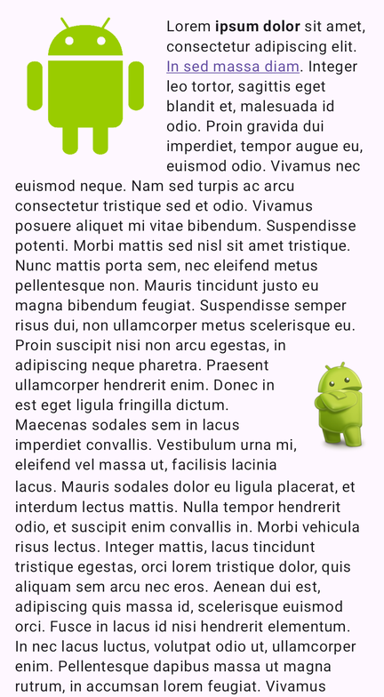
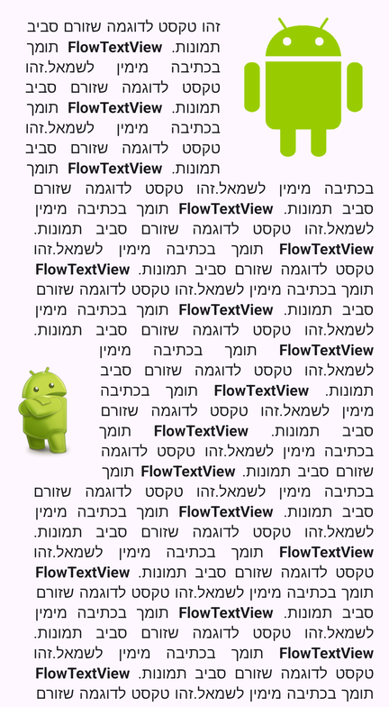

FlowTextView
============

[](https://github.com/deano2390/FlowTextView/actions/workflows/ci.yml)
[](https://jitpack.io/#deano2390/FlowTextView)

An Android layout whose text flows around its child views.

`FlowTextView` is a `RelativeLayout` and a text view in one. Add images (or any other views) as
children, position them with the usual `RelativeLayout` rules, set some text, and the text wraps
around them.

 

Features
--------

- Text wraps around every visible child, on either side, and continues below children that span the
  full width.
- Any styled text: `Html.fromHtml`, `SpannableString` and every span `TextView` supports (bold,
  italic, colour, size, underline, images…).
- Clickable links and any `ClickableSpan`, with a pressed highlight.
- Right-to-left scripts, justification, hyphenation and line break strategies.
- The `TextView` XML attributes you would expect, including `android:textAppearance`, and theme
  defaults that follow light and dark mode.
- Accessible: TalkBack reads the text, and links can be reached and activated by touch exploration,
  Switch Access and keyboard.
- Fast: text is laid out once per size or content change and drawn from a cache.

Download
--------

Add JitPack to your repositories in `settings.gradle.kts`:

```kotlin
dependencyResolutionManagement {
    repositories {
        google()
        mavenCentral()
        maven("https://jitpack.io")
    }
}
```

Then add the dependency:

```kotlin
dependencies {
    implementation("com.github.deano2390:FlowTextView:3.0.0")
}
```

Requires `minSdk` 23 or higher.

Usage
-----

Add the view to a layout with your child views inside it:

```xml
<uk.co.deanwild.flowtextview.FlowTextView
    android:id="@+id/flowTextView"
    android:layout_width="match_parent"
    android:layout_height="wrap_content"
    android:padding="16dp"
    android:textAppearance="?attr/textAppearanceBodyLarge">

    <ImageView
        android:layout_width="wrap_content"
        android:layout_height="wrap_content"
        android:layout_alignParentStart="true"
        android:layout_marginEnd="12dp"
        android:layout_marginBottom="8dp"
        android:src="@drawable/photo" />

    <ImageView
        android:layout_width="wrap_content"
        android:layout_height="wrap_content"
        android:layout_alignParentEnd="true"
        android:layout_marginTop="360dp"
        android:layout_marginStart="12dp"
        android:src="@drawable/diagram" />
</uk.co.deanwild.flowtextview.FlowTextView>
```

Then set the text in code.

Kotlin:

```kotlin
val flowTextView = findViewById<FlowTextView>(R.id.flowTextView)
flowTextView.text = HtmlCompat.fromHtml(html, HtmlCompat.FROM_HTML_MODE_LEGACY)
flowTextView.onLinkClickListener = OnLinkClickListener { url -> openInBrowser(url) }
```

Java:

```java
FlowTextView flowTextView = findViewById(R.id.flowTextView);
flowTextView.setText(HtmlCompat.fromHtml(html, HtmlCompat.FROM_HTML_MODE_LEGACY));
flowTextView.setOnLinkClickListener(url -> openInBrowser(url));
```

### How text flows around children

- Every child that is not `GONE` is avoided. On each line, the text uses the widest gap that is
  left.
- A child's left, right and bottom margins are kept clear of text. Its top margin only positions it,
  so you can use `layout_marginTop` to move an image down the page.
- Where a child leaves no gap at least one em wide, the text continues below it.
- With `layout_height="wrap_content"`, the view is tall enough for both the text and the children.

### Links

`URLSpan` links, such as `<a href>` tags from `Html.fromHtml`, open their URL when tapped. Set an
`OnLinkClickListener` to handle the URL yourself. Any other `ClickableSpan` receives `onClick()`.
Taps anywhere else are passed on as usual, so the view scrolls normally and can have its own click
listener.

### XML attributes

| Attribute | Notes |
|---|---|
| `android:text` | Styled string resources keep their styling. |
| `android:textAppearance` | Supplies defaults for the attributes below, as for `TextView`. |
| `android:textSize`, `android:textColor`, `android:textColorLink`, `android:textColorHighlight` | Colour state lists are supported. |
| `android:fontFamily`, `android:textStyle`, `android:letterSpacing` | `fontFamily` accepts `@font` resources and family names. |
| `android:lineSpacingExtra`, `android:lineSpacingMultiplier`, `android:includeFontPadding` | |
| `android:breakStrategy`, `android:hyphenationFrequency`, `android:justificationMode` | Justification requires API 26. |
| `android:textAlignment`, `android:textDirection` | Standard `View` attributes. `android:gravity` still positions children, as in any `RelativeLayout`. |

A default style can be set for the whole app with the `flowTextViewStyle` theme attribute.

Each attribute has a matching property, for example `textSize`, `textColor` and
`justificationMode`. `setTextSize(TypedValue.COMPLEX_UNIT_SP, 18f)` sets the size in a given unit.

### Jetpack Compose

There is no Compose version of `FlowTextView`. You can host it in Compose with `AndroidView`:

```kotlin
AndroidView(
    factory = { context ->
        FlowTextView(context).apply {
            addView(ImageView(context).apply { setImageResource(R.drawable.photo) })
        }
    },
    update = { it.text = text },
)
```

Upgrading from 2.x
------------------

3.0 is a rewrite. Most 2.x code keeps compiling, with deprecation warnings that point to the
replacements. The behaviour changes and removed APIs are listed in the
[changelog](CHANGELOG.md#migrating-from-2x).

Building
--------

Building needs JDK 21, which Robolectric needs to run the tests against API 37. The library itself
targets Java 17.

```shell
./gradlew build                   # tests, screenshot verification, lint and assemble
./gradlew :flowtextview-sample:installDebug
./gradlew recordRoborazziDebug    # re-record screenshot goldens after an intentional visual change
```

License
-------

    Copyright 2014 Dean Wild

    Licensed under the Apache License, Version 2.0 (the "License");
    you may not use this file except in compliance with the License.
    You may obtain a copy of the License at

       http://www.apache.org/licenses/LICENSE-2.0

    Unless required by applicable law or agreed to in writing, software
    distributed under the License is distributed on an "AS IS" BASIS,
    WITHOUT WARRANTIES OR CONDITIONS OF ANY KIND, either express or implied.
    See the License for the specific language governing permissions and
    limitations under the License.


History
-------

I needed to have a text wrap around images and other views in an Android App but I was surprised and frustrated to discover that there was no way to do this natively.

The general consensus was that the only practical way to achieve this was to use WebViews.

Using webviews is a bit bloaty and overkill to achieve this. We lose the direct control and performance of using native widgets.

So I developed a native widget which extends RelativeLayout (I figured this was more versatile than LinearLayout) which is capable of painting text around its child views.

Version 3.0 rebuilt it on the platform's own text layout, `StaticLayout`, which takes care of the
original to-do list: XML attributes, full HTML styling, right-to-left text and performance.
